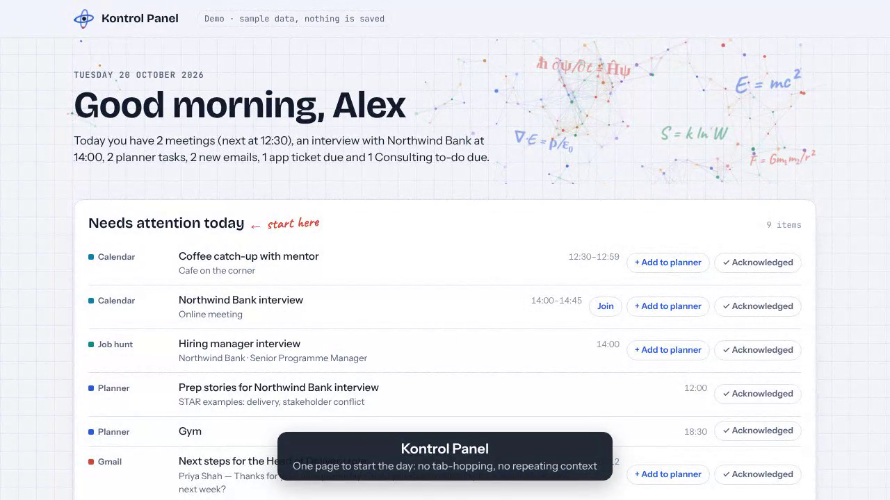
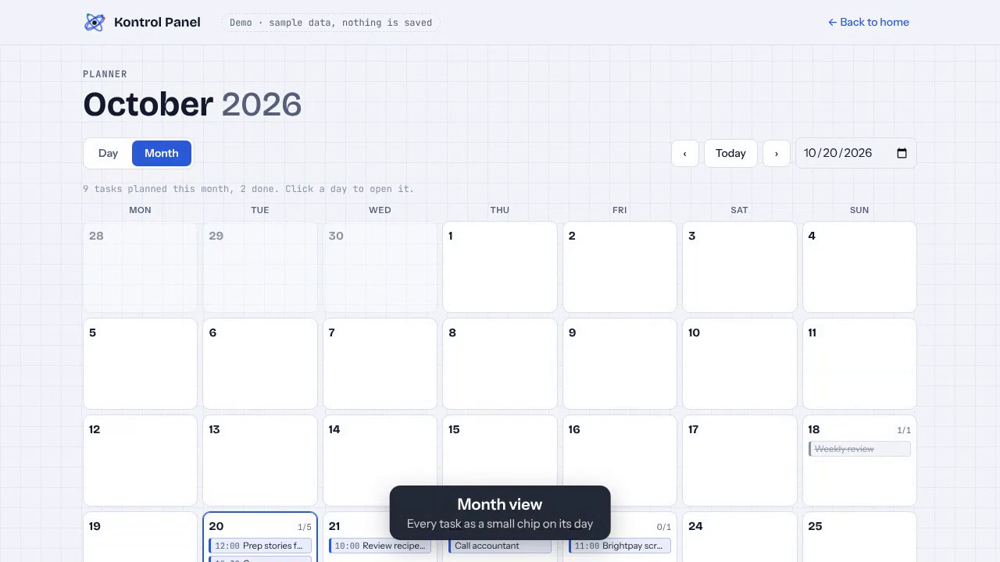
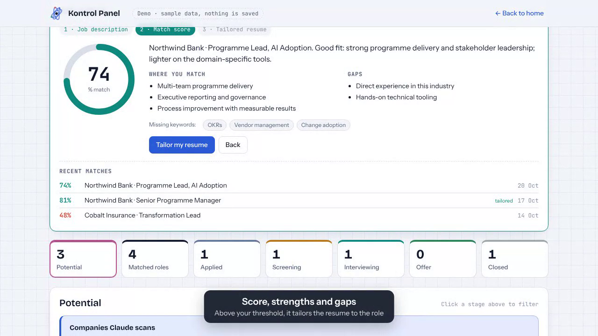
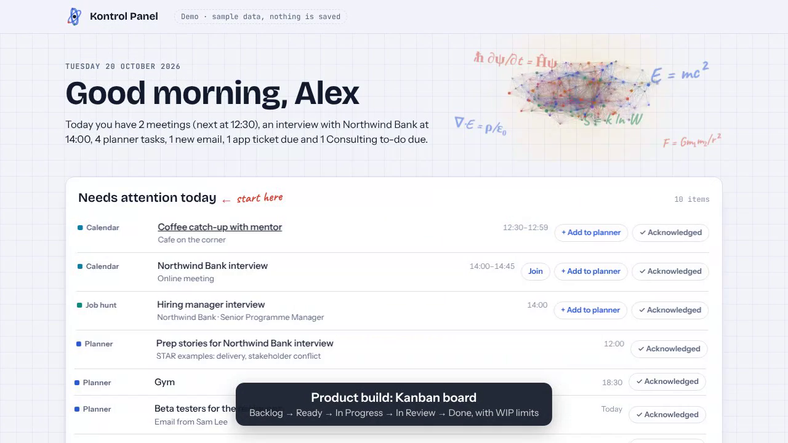

# Kontrol Panel

**One page to start the day.** Kontrol Panel is a personal start-of-day hub that runs as a [Claude](https://claude.ai) artifact. Open one tab in the morning and you see what needs your attention across your calendar, inbox, planner, job hunt and side projects, and you can act on it there without copying context or data between tools.

The north star: **open one tool, get everything you need, never repeat yourself.**



## What's inside

| Area | What it does |
|---|---|
| **Needs attention today** | One list built from Google Calendar meetings, today's Gmail, interviews, planner tasks and anything due. Each item can be added to the planner or acknowledged (cleared for the day). |
| **Planner** | Day view with a week strip, month view with tasks as small chips, and a backlog you can drag onto any day. |
| **Job hunt** | A pipeline (Potential → Applied → Screening → Interviewing → Offer → Closed, plus Not suitable), match scores, next steps and an editable package column. |
| **Job match** | Paste a job description and Claude scores it 0–100% against your resume, listing strengths, gaps and missing keywords. Above 65% it tailors a copy of your `.docx` resume (formatting kept), which you can preview and download as `Firstname_Surname_Company_JobTitle.docx`. |
| **Potential roles + Refresh** | Keep a list of companies' careers pages. **Refresh** starts a Claude scheduled task that scans them, scores each role against your resume and adds new matches (skipping roles you rejected or saw in the last 7 days). |
| **Product build** | A Kanban board: Backlog → Ready → In Progress (WIP 3) → In Review (WIP 3) → Done, with priorities and due dates. |
| **Side project** | A simple to-do list for a second project (rename it in `CONFIG`). |
| **Backup** | Downloads everything as one Excel workbook. |

| Planner | Job match | Kanban |
|---|---|---|
|  |  |  |

## Try the demo

`demo.html` is the same page running on fictional sample data ("Alex Morgan"). Nothing is saved and nothing connects to your accounts. Open it in any browser, or ask Claude to publish it as an artifact.

## Set up your own

You need a Claude account with artifacts, and ideally the **Gmail** and **Google Calendar** connectors.

1. **Edit `CONFIG`.** Open `kontrol-panel.html`, find the `CONFIG` block at the top of the main script and set:
   - `productName`: the name of your product (Kanban tab)
   - `sideName`: the name of your fourth tab (side business, studies, etc.)
   - `filePrefix`: e.g. `Jane_Smith`, used for tailored resume file names
   - `productLinks` / `sideLinks`: optional quick links, e.g. `[{label:"Prototype", url:"https://…"}]`
   - leave `scanTaskId` empty for now and `demo: false`
2. **Publish it with Claude.** Attach `kontrol-panel.html` in a Claude chat and paste the prompt in [`docs/setup-prompt.md`](docs/setup-prompt.md). Claude publishes it as a private artifact with the right capabilities (private database, Gmail/Calendar, Claude for job matching, downloads).
3. **Open the artifact and approve** the Gmail and Calendar access it asks for.
4. **Add your resume.** In *Job hunt → Job match*, click **Upload a resume (.docx)**. Bullets written as "**Bold lead-in:** detail" are kept bold when tailoring.
5. **(Optional) Turn on Refresh.** Add companies under *Potential → Companies Claude scans*. Then ask Claude to create the scheduled task in [`docs/scan-task-prompt.md`](docs/scan-task-prompt.md), put its ID (`trig_…`) in `CONFIG.scanTaskId`, and ask Claude to republish the page.
6. **Pin it.** Bookmark the artifact link, or install it as an app from your browser (⋮ → Cast, save and share → Install page as app) and pin it to your taskbar.

### Capabilities used

```json
{
  "db": { "rules": [{ "path": "", "read": "owner", "write": "owner" }] },
  "user": { "scopes": ["profile"] },
  "mcp": { "servers": [
    { "server": "Gmail", "tools": ["search_threads"] },
    { "server": "Google Calendar", "tools": ["list_events"] },
    { "server": "Claude Code Remote", "tools": ["fire_trigger"] }
  ] },
  "downloads": {},
  "sample": {}
}
```
Drop the `Claude Code Remote` entry if you don't use Refresh. Capability names and shapes can change; Claude will adjust them when it publishes.

## Privacy

- Your data lives in the artifact's own database with **owner-only** read and write rules. If you share the link, other people see an empty page, not your data.
- Gmail and Calendar are read through Claude's connectors under your account. The page only reads: it searches today's inbox and lists today's events.
- The job scan only reads public careers pages. It never applies, signs in or submits forms.
- Before sharing your own copy, check `CONFIG` and the links for anything personal.

## Data model

Collections: `planner`, `backlog`, `jobs`, `companies`, `tasks` (Kanban), `quickwin` (side project), `resumes`, `matches`, `tailored`, `dismissed`, and `scan` (`info`, `rejected`, `seen`). See [`docs/scan-task-prompt.md`](docs/scan-task-prompt.md) for the job fields the scan writes.

## Credits

Designed by a delivery lead who wanted one front door to her day, inspired by the "single pane of glass" platforms built for enterprise teams. Built with Claude.

MIT licensed (see [LICENSE](../LICENSE)).
